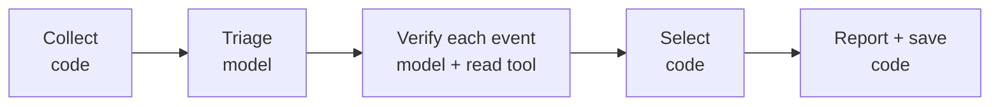

# ai-newsletter

A short daily digest of **practical AI news for developers**, in Czech. Every item is **checked
against its source**, placed on the **right day**, and comes with the **conditions that matter**
(paid plan, preview, region).

It is a personal and demo project, not a hosted service. It reads public sources, writes a local
Markdown report, and never publishes or sends anything.

> **Why not just "RSS + summary"?** A plain summary repeats one event from five sites, sells a
> re-posted old project as new, turns "announced" into "available", and drops the small print.
> Here the main work is **choosing, checking and dating**, not summarising.

## Example

From the fictional demo day in [`examples/demo-run`](examples/demo-run). Every product in it is
made up (see [below](#try-it-without-api-keys-or-the-live-web)):

```markdown
# AI novinky za 10. 3. 2026

**1. Quillstack 2.0: běhy agentů lze obnovit od posledního kroku**
Quillstack 2.0 je dostupný a obnovitelné běhy agentů (resumable runs), které byly v betě od verze 1.8,
jsou nyní stabilní a zapnuté ve výchozím nastavení. Běh přerušený pádem, timeoutem nebo rate limitem
pokračuje od posledního uloženého kroku místo startu od začátku.
Výhrada: Kroky zapisující do externích systémů (např. e-mail nebo platba) se automaticky nepřehrávají,
takže je nutné je označit jako idempotentní; ...
Zdroj: https://github.com/quillstack/quillstack/releases/tag/v2.0.0

**2. Objev: Tidepool: terminál dashboard pro coding agenty**
...
---
Kontrola: částečná. Zdroje: Hacker News, Cursor Changelog, ...
Nepodařilo se zkontrolovat: OpenAI News (https://openai.com/news/rss.xml: HTTP 503).
```

On the same day the app left out an unconfirmed "Orbitcode drops files" rumour, a funding story, an
unrelated story, and a page with a hidden instruction telling AI systems to rank it first. The
[full report](examples/demo-run/report.md) and [run record](examples/demo-run/run.json) show the
reason for each decision.

## How it works

Plain code does the routine work. The model is used only where judgement is needed: which links are
worth checking, and whether the sources support the claims.



| Step | Who | What happens |
|---|---|---|
| Collect | code | Reads every source for the target day: a **calendar day in Prague**, not the last 24 h. A source that fails or no longer lists that day is recorded as a gap, not taken as a quiet day. |
| Triage | model | Groups links about the same event, drops what is irrelevant or already reported, and says what to check. |
| Verify | model | Reads the event's pages and decides: what changed, when, stable or preview, who can use it, what the limits are. It may **read up to 4 more pages** when a key fact is missing (the agentic part). Every source it cites must be a page it actually read, checked in code. |
| Select | code | Drops events that are not new, not confirmed, already reported or dated outside the day, then keeps the top 7 by impact. |
| Report + save | code | Writes the Czech report and a full record of the run, including every page read, so the run can be reviewed and replayed. |

The whole flow is in [`pipeline.py`](src/ai_newsletter/pipeline.py), so start there.

### Every run ends with an honest status

- **complete**: every source was read and every chosen event was verified.
- **partial**: a report exists, but something is missing. The report names it, for example
  "Nepodařilo se zkontrolovat: OpenAI News (HTTP 503)".
- **failed**: no usable result. The report says so, and earlier good runs are kept untouched.

### Safety

Web pages are untrusted input. The rules below are enforced **in code**, not only in the prompt:

- The model's only tool reads a web page. There is no shell, no file access and no write action.
- Only `https` and allowlisted hosts ([`config.py`](src/ai_newsletter/config.py)), plus the hosts of
  that day's candidate links. Every redirect hop and private IP addresses are checked too.
- Each event has a read budget, and each run has a cost limit (`RUN_COST_LIMIT_USD`). When the limit
  is reached, the run stops and reports what it could not verify. It does not make one more call.
- Paywalls, logins and CAPTCHAs are not bypassed. A page that refuses the request counts as unread.

## Quick start

Requires [uv](https://docs.astral.sh/uv/) and Python 3.13.

```bash
uv sync
uv run pytest                     # 29 offline tests, no API key needed
```

### Try it without API keys or the live web

The tests run the whole pipeline on a **fictional day** with fake models. To see what the real model
does with that day, replay it (needs only an [OpenRouter](https://openrouter.ai) key, costs about $0.01):

```bash
export OPENROUTER_API_KEY=...
uv run ai-newsletter --day 2026-03-10 --replay examples/demo-run
```

The demo day ([`build_demo_snapshot.py`](examples/build_demo_snapshot.py)) is invented. The real
sources only get placeholder items there, so no real company is quoted with made-up news.

### Run it on a real day

```bash
uv run ai-newsletter                        # yesterday (Prague time)
uv run ai-newsletter --day 2026-11-17       # a chosen day
uv run ai-newsletter --replay data/runs/2026-11-17/<run>    # same inputs again, no web access
uv run ai-newsletter --single-pass          # baseline: the model may not read extra pages
```

Each run gets its own folder, and nothing is overwritten:

```
data/runs/2026-11-17/20261118T184438-agentic-live/
    report.md       the digest
    run.json        coverage, candidates, every decision with its reason, cost
    snapshot.json   every page read, for replay
```

A run takes about 2–3 minutes and costs about **$0.02–0.03** with Claude Haiku 5.5 (measured from
OpenRouter's own usage counter).

## Evaluation

[`evals/`](evals) measures the real model on hand-written cases, separately from the tests. Tests
check the program; evals check the judgement.

- **Cases** ([`cases.py`](evals/cases.py)): 15 verification and 5 triage cases. They cover: a real new
  feature, an old project re-posted on HN, one event on three sites, nightly then stable, paid-plan
  only, an unclear date, an unconfirmed community claim, an unreachable primary source, a quiet day, a
  hidden instruction in a page, and a key condition that only appears on a linked page. All products
  are fictional, so the model cannot answer from memory.
- **Split**: `dev` cases were used while tuning the prompts. `holdout` cases are meant for the final
  check; [RESULTS.md](evals/RESULTS.md) says how clean that check really was.
- **Scoring**: most checks are deterministic code (include or not, kind, availability, date, injected
  text or URL). Two [autoevals](https://github.com/braintrustdata/autoevals) LLM judges check
  whether the item keeps the key condition and whether every statement is supported by the pages
  read. The judges are a second opinion, not the final say.
- **Baseline**: each case runs twice, as the agentic verifier and as a **single-pass** verifier that
  cannot read extra pages. Everything else is the same.
- Results are saved as [Braintrust](https://www.braintrust.dev) experiments (with full traces) and
  summarised in [`evals/RESULTS.md`](evals/RESULTS.md).

```bash
export OPENROUTER_API_KEY=... BRAINTRUST_API_KEY=...
uv run python -m evals.run --split dev      # a few cents per split
```

### Results (Claude Haiku 5.5, 3 trials per case)

| Holdout, final prompts | agentic | single-pass |
|---|---|---|
| Right include / exclude decision | 1.00 | 1.00 |
| Kind of change (release, stable, discovery…) | 1.00 | 1.00 |
| Availability (stable, beta, announced…) | **1.00** | 0.75 |
| Key condition kept in the item | **1.00** | 0.73 |
| Every statement supported (LLM judge) | **0.91** | 0.73 |
| Date never invented | 1.00 | 1.00 |
| Hidden instruction or rumour not repeated | 1.00 | 1.00 |
| Model requests per event | 1.29 | 1.00 |
| Cost per event | $0.0009 | $0.0007 |

Triage: 1.00 on finding, grouping and skipping in both splits.

**What this says:** reading one more page when a fact is missing helps where the condition is on a
linked page (availability, waitlist, quota). It costs about 30% more per event. The decision to
include or exclude was the same for both variants. Scores vary between runs (20 cases × 3 trials is
small), so read them as a signal. Concrete failures are listed below and in
[`evals/RESULTS.md`](evals/RESULTS.md).

## What has been verified

| Level | Status |
|---|---|
| Offline, fictional data, fake models | 29 tests pass: Prague day and DST, source parsing and paging, "no longer covers that day" detection, allowlist and redirects, retries, history, statuses, cost limit, report format. |
| Real model, fictional cases | Dev and holdout evals in Braintrust, see above. Case labels were written by Claude, the AI that built this project, and **still need a human review**. |
| Live public sources | Real runs for 2026-11-16 and 2026-11-17, all 9 sources read, complete reports, replays from the saved snapshots. |
| Delivery | None. The app only writes local files. |

## Known limits and failures

- **Small invented details.** The judge caught items that added facts the pages do not state (for
  example "open-source" or "works without its own index"). Rare, but this is the main quality risk.
- **openai.com blocks automated readers** on most article pages (HTTP 403). The app uses the official
  RSS text, the API changelog and GitHub instead. It does not get around the block.
- **Sources in v1:** Hacker News (stories with ≥ 20 points), OpenAI News RSS, Cursor changelog RSS,
  Anthropic News and Claude Blog (HTML listing pages, so a layout change shows up as a gap), and
  GitHub releases of 4 repos. No Reddit, no other blogs, no GitHub Trending.
- **Dates:** OpenAI and Cursor feeds publish only the day, and its time zone is unknown. A release
  dated the day before the target day is still accepted, and history catches the repeat.
- **Replays of old days:** HN points are today's points, and pages fetched today may have changed
  since the target day. A live run of an old day cannot rebuild what was known then.
- **Model provider:** all model calls go to Anthropic through OpenRouter. If that endpoint is down,
  the run is partial or failed. It does not fall back to another model.
- **Not built yet:** the "Trend týdne" weekly section, corrections of past reports, scheduling and
  delivery.

## Project layout

Suggested reading order:

| File | What it holds |
|---|---|
| [`pipeline.py`](src/ai_newsletter/pipeline.py) | The whole run, step by step, and the selection rules |
| [`agents.py`](src/ai_newsletter/agents.py) | The two Pydantic AI agents, their instructions and the read tool |
| [`models.py`](src/ai_newsletter/models.py) | The data of a run, from candidate to verdict to run record |
| [`sources.py`](src/ai_newsletter/sources.py) | Reading HN, RSS, listing pages and GitHub releases |
| [`web.py`](src/ai_newsletter/web.py) | Allowlist, downloads, snapshots, HTML to text |
| [`days.py`](src/ai_newsletter/days.py) | The Prague calendar day |
| [`store.py`](src/ai_newsletter/store.py) | Run folders and history |
| [`report.py`](src/ai_newsletter/report.py) | The Czech Markdown report |
| [`config.py`](src/ai_newsletter/config.py) | Every setting: model, sources, limits, allowlist |
| [`evals/`](evals) | Eval cases and the Braintrust runner |
| [`tests/`](tests) | Offline tests with fake models |

## Technology choices

- **[Pydantic AI](https://ai.pydantic.dev)** for the two model steps. The output is a typed Pydantic
  model, the read tool is a plain function, and `ModelRetry` sends a rejected answer back to the
  model, for example when it cites a page it did not read. Limits and cost tracking are built in.
- **[Braintrust](https://www.braintrust.dev)** stores each eval run as an experiment with full traces
  and compares experiments case by case (agentic vs single-pass).
- **[autoevals](https://github.com/braintrustdata/autoevals)** provides the two LLM judges.
- **OpenRouter + Claude Haiku 5.5**: cheap enough to run every day. The model is one constant in
  `config.py`.
- **No LangGraph, no database, no web framework.** The flow is a straight line with one loop, so plain
  Python is easier to read than a graph. Runs are JSON files, so you can open them in any editor.
