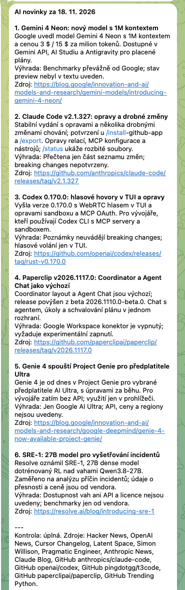
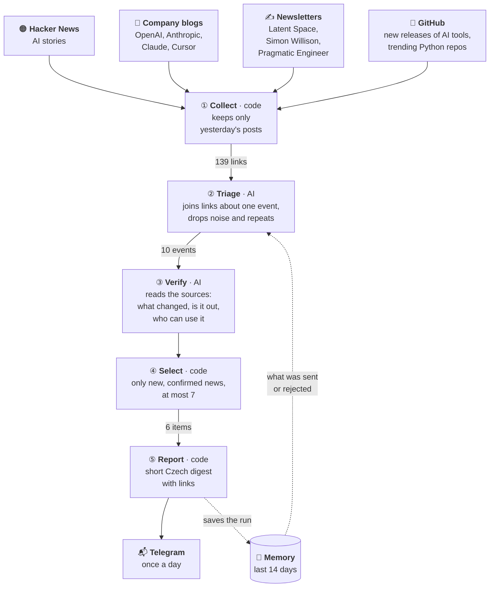

<div align="center">


# ai-newsletter

**A short, verified daily digest of practical AI news for developers.**<br>
Every item is checked against its source, placed on the right day,<br>
and comes with the conditions that matter.

[](https://www.python.org)
[](https://ai.pydantic.dev)
[](https://www.braintrust.dev)
[](LICENSE)

[Example](#example) · [How it works](#how-it-works) · [Quick start](#quick-start) · [Evaluation](#evaluation) · [Limits](#known-limits)

</div>

<br>

## Why

A plain "RSS + summary" gets the hard parts wrong. Here the main work is **choosing, checking and
dating**, not summarising.

| A plain summary… | This project… |
|---|---|
| repeats one event from five sites | groups them into **one item** |
| sells a re-posted old project as new | labels it **"Objev"** (discovery) or leaves it out |
| turns "announced" into "available" | says **stable, preview, beta or waitlist** |
| drops the small print | keeps the key condition as **"Výhrada"** (caveat) |

**At a glance**

- 💰 **About $0.025 per day**, about 110× less than the general-purpose agent it replaced ([cost](#cost))
- 🔎 **Checked in code:** an item may cite only pages the model actually read
- 🧪 **Measured:** evals in Braintrust compare an agentic and a single-pass verifier ([evaluation](#evaluation))
- 🔒 **Web pages are untrusted:** one read-only tool, host allowlist, hard cost limits ([safety](#safety))
- 📬 **Delivered once a day** to Telegram, if you want it

> [!NOTE]
> A personal and demo project, not a hosted service. It reads public sources, writes a local
> Markdown report, and sends it only when asked to, to your own Telegram chat. The digest is in
> Czech; the code, prompts and docs are in English.

<br>

## Contents

- [Example](#example) · [Demo day](#the-demo-day)
- [How it works](#how-it-works) · [Run status](#every-run-ends-with-an-honest-status) · [Memory](#memory) · [Safety](#safety)
- [Quick start](#quick-start) · [Demo day](#1-try-it-on-the-demo-day) · [Real day](#2-run-it-on-a-real-day) · [Telegram](#3-send-it-to-telegram)
- [Cost](#cost)
- [Evaluation](#evaluation)
- [What has been verified](#what-has-been-verified)
- [Known limits](#known-limits)
- [Project layout](#project-layout)
- [Technology choices](#technology-choices)

<br>

## Example

A real report for 18 November 2026, as it arrives in Telegram:

<p align="center">
  
</p>

Items are short on purpose: the link has the details. Each one says **what changed**, **why it
matters**, the **caveat** ("Výhrada") and the **source** ("Zdroj"). The last lines list every source
that was checked.

### The demo day

The repo also contains a **fictional demo day** in [`examples/demo-run`](examples/demo-run), which you
can [replay yourself](#1-try-it-on-the-demo-day). Every product in it is made up, so no real company
is quoted with invented news. Its full report:

```markdown
# AI novinky za 10. 3. 2026

**1. Quillstack 2.0 je dostupný, obnovení běhů je stabilní**
Běhy agentů lze obnovit od posledního uloženého kroku; funkce je stabilní a ve výchozím stavu zapnutá.
Méně opakovaného práce po pádu, timeoutu nebo rate limitu.
Výhrada: Kroky zapisující do externích systémů se nereplayují automaticky.
Zdroj: https://github.com/quillstack/quillstack/releases/tag/v2.0.0

**2. Lumen Agents přidává sdílené týmové workspaces**
Týmové workspaces sdílí agenty, tajemství a historii běhů s rolemi owner, editor, viewer.
Týmová spolupráce na agentech, tajemstvích a bězích v jednom místě.
Výhrada: Jen Pro a Enterprise; Free nemá; zavádění 7 dní.
Zdroj: https://lumenagents.dev/changelog/team-workspaces

**3. Objev: Tidepool: terminálový dashboard pro kódovací agenty**
Terminálový dashboard zobrazuje příkazy, tokeny a změněné soubory kódovacích agentů.
Přehled o činnosti agentů v terminálu; podporuje agenty s JSON logy.
Výhrada: Pouze Linux a macOS; licence a instalace neověřeny.
Zdroj: https://github.com/tidepool-dev/tidepool

---
Kontrola: částečná. Zdroje: Hacker News, Cursor Changelog, Latent Space, …
Mezery v pokrytí: OpenAI News (https://openai.com/news/rss.xml: HTTP 503).
```

On that day the app **left out**:

- an unconfirmed "Orbitcode drops files" rumour,
- a funding story and an unrelated story,
- a page with a hidden instruction telling AI systems to rank it first.

The [run record](examples/demo-run/run.json) gives the reason for every decision.

<br>

## How it works

Plain code does the routine work. The model is used only where judgement is needed: which links are
worth checking, and whether the sources support the claims.



<sub>The numbers are from the real run for 18 November 2026.</sub>

| Step | Who | What happens |
|---|---|---|
| **Collect** | code | Reads every source for the target day: a **calendar day in Prague**, not the last 24 h. A source that fails, or no longer lists the whole day, is a gap, not a quiet day. |
| **Triage** | model | Groups links about the same event, drops what is irrelevant or already reported, and says what to check. |
| **Verify** | model | Decides what changed, when, stable or preview, who can use it and the limits. May **read up to 4 more pages** when a key fact is missing (the agentic part). |
| **Select** | code | Drops what is not new, not confirmed, already reported, a duplicate or dated outside the day. Keeps the top 7 by impact. |
| **Report + save** | code | Writes the Czech report and a full record of the run, including every page read, so it can be reviewed and replayed. |

The whole flow is in [`pipeline.py`](src/ai_newsletter/pipeline.py): start there.

### Every run ends with an honest status

| Status | Meaning |
|---|---|
| `complete` | Every source was read and every chosen event was verified. |
| `partial` | A report exists, but something is missing, and the report names it (e.g. *Mezery v pokrytí: OpenAI News (HTTP 503)*). |
| `failed` | No usable result: the report says so, and earlier good runs are kept untouched. If no event could be verified at all, the run is failed, not a quiet day. |

### Memory

There is no database. Every run is a folder of files. Before a run, the app reads the latest
successful agentic live run of each of the **last 14 days** and takes two things from them:

- **Published items** (title, kind, source URL). Both models see them, so a repeat is skipped and a
  stable release can say it follows an earlier preview. In code, an already published source URL is
  dropped.
- **Rejected links** with their reason. When a link shows up again, triage sees
  *"rejected earlier (2026-11-16): …"* and skips it unless there is something new. This is a hint, not
  a hard filter: a repo rejected as an old project may later get a real release.

Links that were never judged (verification failed, or the item lost only to the 7-item limit) are
not remembered as rejected.

### Safety

Web pages are untrusted input. These rules are enforced **in code**, not only in the prompt:

- 🔧 **One tool, read-only.** The model can only read a web page: no shell, no files, no writes.
- 🌐 **Allowlist.** Only `https` and the hosts in [`config.py`](src/ai_newsletter/config.py), plus
  the hosts of that day's candidate links. Every redirect hop and private IP address is checked. A
  link inside a page does not widen the allowlist.
- 📑 **Cited means read.** Every URL an included item cites must be a page the model read, or the
  source's own feed text. Otherwise the answer goes back to the model.
- 💸 **Budgets.** A read budget per event, plus a cost limit (`RUN_COST_LIMIT_USD`) and a request cap
  per run. Once spent, nothing more is verified and the report lists what stayed unverified.
- 🚫 **No bypassing.** Paywalls, logins and CAPTCHAs are respected; a refused page counts as unread.

<br>

## Quick start

Requires [uv](https://docs.astral.sh/uv/) and Python 3.13.

```bash
uv sync
uv run pytest        # 41 offline tests, no API key needed
```

### 1. Try it on the demo day

The tests run the whole pipeline on a fictional day with fake models. To see what the **real model**
does with that day, replay it. It needs only an [OpenRouter](https://openrouter.ai) key and costs
about $0.01.

```bash
export OPENROUTER_API_KEY=...
uv run ai-newsletter --day 2026-03-10 --replay examples/demo-run
```

The demo day is built by [`build_demo_snapshot.py`](examples/build_demo_snapshot.py). Real sources
only get placeholder items there.

### 2. Run it on a real day

```bash
uv run ai-newsletter                                        # yesterday (Prague time)
uv run ai-newsletter --day 2026-11-17                       # a chosen day
uv run ai-newsletter --replay data/runs/2026-11-17/<run>    # the same pages again, no web access
uv run ai-newsletter --single-pass                          # baseline: no extra page reads
```

A run takes **2–3 minutes**. Each run gets its own folder, and nothing is overwritten:

```
data/runs/2026-11-17/20261118T184438-agentic-live/
├── report.md       the digest
├── run.json        coverage, candidates, every decision with its reason, cost
└── snapshot.json   every page read, for replay
```

History ("already reported?") always comes from the earlier days in `--data-dir`, also on a replay.

### 3. Send it to Telegram

1. Create a bot with [@BotFather](https://t.me/BotFather) (`/newbot`) and send the bot any message.
2. Find your chat id with [@userinfobot](https://t.me/userinfobot), or open
   `https://api.telegram.org/bot<TOKEN>/getUpdates` and take `message.chat.id`.
3. *Optional:* to post into one topic of a group, set `TELEGRAM_CHAT_ID` to the group id (`-100…`)
   and `TELEGRAM_THREAD_ID` to the topic id. Both are in a message link from that topic:
   `t.me/c/<group>/<topic>/<message>`, where the group id is `-100<group>`.
4. Run with `--telegram`:

```bash
export TELEGRAM_BOT_TOKEN=... TELEGRAM_CHAT_ID=...
uv run ai-newsletter --telegram                                     # run yesterday and send it
uv run python -m ai_newsletter.telegram data/runs/2026-11-17/<run>  # send an earlier run
```

For a daily digest, run it from cron or a systemd timer after midnight Prague time, and keep the same
`data/` folder between runs: it is the app's memory.

<details>
<summary><b>How delivery stays safe</b></summary>

<br>

Delivery is kept apart from the pipeline ([`telegram.py`](src/ai_newsletter/telegram.py)):

- **At most one report per day.** The state is in `data/runs/<day>/telegram.json`.
- **A clear refusal** from Telegram (e.g. a rate limit) can be retried.
- **A broken connection** mid-send is never retried blindly: check the chat, then delete
  `telegram.json` to send again.
- **Replays and single-pass runs** are never sent.
- **A failed run** sends its short "Kontrola nebyla dokončena" note, not an empty digest.
- The bot can be one you already use: this app only sends, it never reads the bot's messages.

</details>

<br>

## Cost

One run costs about **$0.02–0.03** with Claude Haiku 5.5, measured by OpenRouter's own usage counter.

Before this project, the same digest was made by a general-purpose agent
([Hermes](https://github.com/NousResearch/hermes-agent) running Codex, with three sub-agents). A
rough estimate for one day, with that run priced as if paid through the API:

| | Cost per digest | 30 days at the same rate |
|---|---:|---:|
| General-purpose agent | ~ $2.71 | ~ $81.43 |
| **This project** | **$0.0246** | **~ $0.74** |

That is **about 110× cheaper**.

> [!CAUTION]
> A rough guide only: it compares a single day, and the two runs did not cover exactly the same
> sources. The agent used 509,232 input tokens, 10,867,584 cached input tokens and 60,919 output
> tokens, priced at the GPT-6.1 Sol list price (standard short-context rates).

<br>

## Evaluation

Tests check the program; **evals check the judgement.** [`evals/`](evals) runs the real model on
hand-written cases and stores every run as a [Braintrust](https://www.braintrust.dev) experiment with
full traces.

| | |
|---|---|
| **Cases** | 15 verification and 5 triage cases in [`cases.py`](evals/cases.py). All products are fictional, so the model cannot answer from memory. |
| **Split** | `dev` cases were used while tuning the prompts; `holdout` cases are for the final check. |
| **Scoring** | Mostly deterministic code. Two [autoevals](https://github.com/braintrustdata/autoevals) LLM judges check the caveat and that every statement is supported. They are a second opinion, not the final say. |
| **Baseline** | Every case also runs on a **single-pass** verifier that cannot read extra pages. Everything else is the same. |

<details>
<summary><b>What the cases cover</b></summary>

<br>

A real new feature · an old project re-posted on HN · one event on three sites · nightly then
stable · paid-plan only · an unclear date · an unconfirmed community claim · an unreachable primary
source · a quiet day · a hidden instruction in a page · a key condition that only appears on a
linked page.

</details>

```bash
export OPENROUTER_API_KEY=... BRAINTRUST_API_KEY=...
uv run python -m evals.run --split dev      # a few cents per split
```

### Results

Claude Haiku 5.5, holdout split, 3 trials per case:

| Score | Agentic | Single-pass |
|---|:---:|:---:|
| Right include / exclude decision | 1.00 | 1.00 |
| Kind of change (release, stable, discovery…) | 1.00 | 1.00 |
| Availability (stable, beta, announced…) | **1.00** | 0.92 |
| Key condition kept in the item | **0.92** | 0.70 |
| Every statement supported (LLM judge) | 1.00 | 1.00 |
| Date never invented | 1.00 | 1.00 |
| Hidden instruction or rumour not repeated | 1.00 | 1.00 |
| Model requests per event | 1.29 | 1.00 |
| Cost per event | $0.0009 | $0.0007 |

Triage scored 1.00 on finding and skipping in both splits, and on grouping in dev (the holdout has no
event spread over several links).

**What this says**

- **Reading one more page pays off** when the condition is on a linked page (availability, waitlist,
  quota). It costs about 30% more per event.
- **The include / exclude decision is the same** for both variants.
- **Short items help faithfulness.** Since the fields were capped at 8–15 words, the judge finds no
  unsupported statements (before: 0.91 agentic, 0.73 single-pass). The price: once in twelve trials,
  a short caveat kept one limit and dropped a second.
- **Read it as a signal.** 20 cases × 3 trials is small, scores move between runs, and the judge is
  the same model as the writer.

Concrete failures and earlier runs are in [`evals/RESULTS.md`](evals/RESULTS.md).

<br>

## What has been verified

| Level | Status |
|---|---|
| **Offline** | 41 tests with fictional data and fake models: Prague day and DST, source parsing and paging, "no longer covers that day" detection, allowlist, malformed URLs and redirects, retries, history and rejections, statuses, usage limit, duplicates, report format. |
| **Real model** | Dev and holdout evals in Braintrust ([above](#evaluation)). Case labels were written by Claude, the AI that built this project, and **still need a human review**. |
| **Live sources** | Real runs for 2026-11-16 and 2026-11-17 (9 sources) and 2026-11-18 (13 sources): all sources read, complete reports, replays from saved snapshots. |
| **Delivery** | 6 offline tests against a fake Telegram API, and one real send to a private chat. |

<br>

## Known limits

**Quality**

- **Small invented details.** The judge used to catch items adding facts the pages don't state
  ("open-source", "works without its own index"). The last eval run found none, but with 20 cases it
  is still the main quality risk.
- **Czech grammar slips.** The text is clear but not always correct, e.g. *"Méně opakovaného práce"*
  in the demo above.
- **Read means downloaded.** A login or paywall page answering HTTP 200 counts as read. The model is
  told to treat it as missing evidence, but the code does not check.

**Sources**

| Source | Kind | Note |
|---|---|---|
| Hacker News | Algolia search | Stories with ≥ 20 points |
| OpenAI News, Cursor changelog | RSS | Only the day is published, not the time. openai.com blocks automated readers on most article pages (HTTP 403); the app uses the RSS text, the API changelog and GitHub instead and does not get around the block. |
| Latent Space | RSS | Also carries smol.ai's daily AINews |
| Simon Willison | Atom | |
| Pragmatic Engineer | RSS | Mostly paywalled, so its posts are leads, not evidence |
| Anthropic News, Claude Blog | HTML listing | A link takes the nearest date shown on the page, which can be a neighbour's. A layout change shows up as a gap. |
| GitHub releases | API | `anthropics/claude-code`, `openai/codex`, `pingdotgg/t3code`, `paperclipai/paperclip` |
| GitHub Trending (Python) | HTML | Shows only "now", so a live run covers it only for yesterday |
| **Reddit** | — | **Not included:** it refuses unauthenticated readers (HTTP 403/404/429) |

**Dates and memory**

- **The day before still counts.** Feeds without a time zone make the edge fuzzy, so a release dated
  the day before is accepted and history catches the repeat. An item whose source shows no date
  passes the check; its caveat should say so.
- **Memory is thin.** It keeps published items and rejected links, not versions or claims. A repeat
  at a different URL is caught only if a model recognises it. Days without a run are gaps.
- **Old days can't be rebuilt.** On a live run of an old day, HN points and pages are today's.

**Operations**

- **One model provider.** All model calls go to Anthropic through OpenRouter, with no fallback; if it
  is down, the run is partial or failed.
- **Not built yet:** the weekly "Trend týdne" section, corrections of past reports, e-mail delivery.
  Scheduling is left to cron.

<br>

## Project layout

Suggested reading order:

| File | What it holds |
|---|---|
| [`pipeline.py`](src/ai_newsletter/pipeline.py) | The whole run, step by step, and the selection rules |
| [`agents.py`](src/ai_newsletter/agents.py) | The two Pydantic AI agents, their instructions and the read tool |
| [`models.py`](src/ai_newsletter/models.py) | The data of a run, from candidate to verdict to run record |
| [`sources.py`](src/ai_newsletter/sources.py) | Reading HN, RSS and Atom feeds, listing pages, GitHub releases and Trending |
| [`web.py`](src/ai_newsletter/web.py) | Allowlist, downloads, snapshots, HTML to text |
| [`days.py`](src/ai_newsletter/days.py) | The Prague calendar day |
| [`store.py`](src/ai_newsletter/store.py) | Run folders and history |
| [`report.py`](src/ai_newsletter/report.py) | The Czech Markdown report |
| [`telegram.py`](src/ai_newsletter/telegram.py) | Sending a report to Telegram, once per day |
| [`config.py`](src/ai_newsletter/config.py) | Every setting: model, sources, limits, allowlist |
| [`evals/`](evals) | Eval cases and the Braintrust runner |
| [`tests/`](tests) | Offline tests with fake models |

<br>

## Technology choices

| Tool | Why |
|---|---|
| **[Pydantic AI](https://ai.pydantic.dev)** | The two model steps. Typed output, the read tool is a plain function, and `ModelRetry` sends a rejected answer back (e.g. a cited page that was not read). Limits and cost tracking are built in. |
| **[Braintrust](https://www.braintrust.dev)** | Each eval run is an experiment with full traces, compared case by case (agentic vs single-pass). |
| **[autoevals](https://github.com/braintrustdata/autoevals)** | The two LLM judges. |
| **OpenRouter + Claude Haiku 5.5** | Cheap enough to run every day. The model is one constant in `config.py`. |
| **No LangGraph, no database, no web framework** | The flow is a straight line with one loop, so plain Python reads better than a graph. Runs are JSON files you can open in any editor. |

<br>

## License

[MIT](LICENSE)

---

Made by [Roman Žydyk](https://romanzdk.com).
